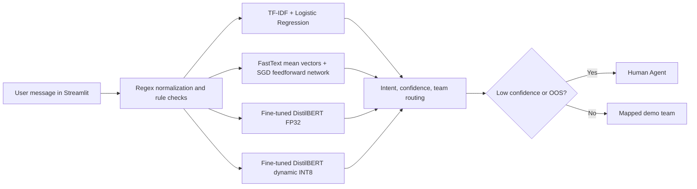

# SWE015 Presentation Outline

Planned length: 10 slides (within the required 8–12). Keep the headings and order aligned with Introduction / Development / Conclusion. Bracketed fields are intentionally empty until the experiments have been run.

## Introduction

### 1. English Multi-Domain Intent Router

- Student name and ID: [add]
- Use case: multi-domain English assistant intent routing with out-of-scope fallback
- Repository: [add link]
- Demo video: [add link]

### 2. Problem and Success Criteria

- A user submits a short message; the system predicts the intent, reports confidence, and routes to a team.
- Low-confidence and out-of-scope messages go to a human agent; greetings/small talk receive rule-based replies.
- Success means comparing four models on the same held-out test set and running the quantized model in the interactive app.

## Development

### 3. Dataset and Splits

- CLINC150 English intent-classification corpus; cite Larson et al. (2019) and the UCI dataset record.
- Full split: 15,100 train, 3,100 validation, 5,500 test (23,700 total); the test split includes 1,000 OOS examples. Cite the [UCI dataset record](https://archive.ics.uci.edu/dataset/570/clinc150).
- Confirm these counts against the downloaded JSON before finalizing the slide.
- Preserve the supplied train, validation, and test splits. Use validation data for model/threshold choices and test data only for final comparison.
- Note: the corpus is a general assistant benchmark; team routing maps its intent domains to demo teams.

### 4. Preprocessing and Classical NLP

- Regex text normalization and product/model-code extraction.
- Small lexicon with edit-distance spelling correction; rule-based small-talk response.
- Classical baseline: TF-IDF + logistic regression.
- Explain that appliance-vocabulary rules are included as a technique demonstration; CLINC150 itself is not appliance-support data.

### 5. Architecture and Data Flow

- Update the diagram after implementation changes so it matches the final code.
- Add actual hardware and where each stage runs after measurement.

### 6. Technique Map

| Required area | Technique | Project component |
|---|---|---|
| A · Neural networks | FastText mean embeddings + feedforward classifier trained with SGD/backpropagation | `src/train.py` |
| B · Classical NLP | Regex normalization, model-code extraction, edit-distance lexicon correction, rule reply, TF-IDF baseline | `src/preprocess.py`, `src/routing.py`, `src/train.py` |
| C · Transformers | Fine-tuned DistilBERT sequence classifier | `src/train.py` |
| D · Efficient models | Dynamic INT8 quantization of the Transformer linear layers | `src/train.py`, `src/models.py` |

### 7. Model Ladder and Training

- TF-IDF + logistic regression.
- FastText embeddings + feedforward network; SGD and backpropagation.
- Fine-tuned DistilBERT classifier.
- Dynamic INT8 DistilBERT; this is the quantized model served by the app.
- State seed, epochs, batch sizes, optimizer, threshold selection, and any deviations from the code.

### 8. Results

Fill this table only after `python -m src.train` completes. Include the measured hardware in the slide.

| Model | Accuracy | OOS recall | Size (MB) | Mean latency (ms, ≥100 runs) |
|---|---:|---:|---:|---:|
| TF-IDF + Logistic Regression | 76.60% | 14.20% | 37.23 | 0.40 |
| FastText + Feedforward | 69.51% | 19.70% | 23.32 | 0.20 |
| DistilBERT | 84.31% | 37.70% | 256.77 | 11.81 |
| DistilBERT INT8 | 84.85% | 42.00% | 133.31 | 6.63 |

- Hardware: Apple M2, 8 GB RAM, 4 PyTorch CPU threads; no GPU/MPS acceleration.
- These values were measured locally on the full 5,500-example test split. Latency is mean single-message inference time over 100 timed runs after warm-up.
- Measurement summary and interpretation: see [RESULTS.md](RESULTS.md).

### 9. Live Application and Failure Analysis

- Show the Streamlit app classifying at least two new messages, including one difficult or out-of-scope case.
- Held-out OOS example: “how much has the dow changed today” was predicted as `spending_history` at 24.12% confidence. The 45% fallback threshold sends it to a human agent despite the wrong top label.
- Limitation: the model can still give a semantically wrong top intent; the fallback threshold only catches some low-confidence errors.
- Next step: [specific improvement supported by the observed error].

## Conclusion

### 10. Findings and AI Usage

- State what the measured comparison showed; explain a trade-off or surprising result.
- Limitations: general assistant corpus, benchmark-to-team mapping, and any measured failure pattern.
- AI usage statement: list the tools actually used and the parts they helped with. Current draft: “OpenAI Codex assisted with project code scaffolding and the presentation outline. All reported metrics will come from our own runs.” Update this if other tools are used.

## Two-Minute Demo Video Plan

- 0:00–0:15: explain the intent-routing problem.
- 0:15–1:15: run two new messages through the app, including one OOS/difficult message.
- 1:15–1:45: show the architecture and measured results table.
- 1:45–2:00: summarize the main finding and limitation.
